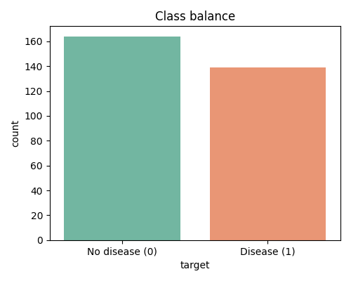
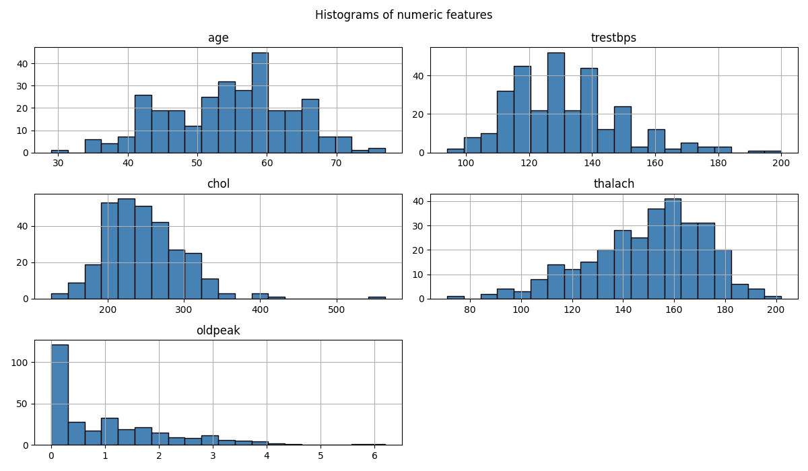
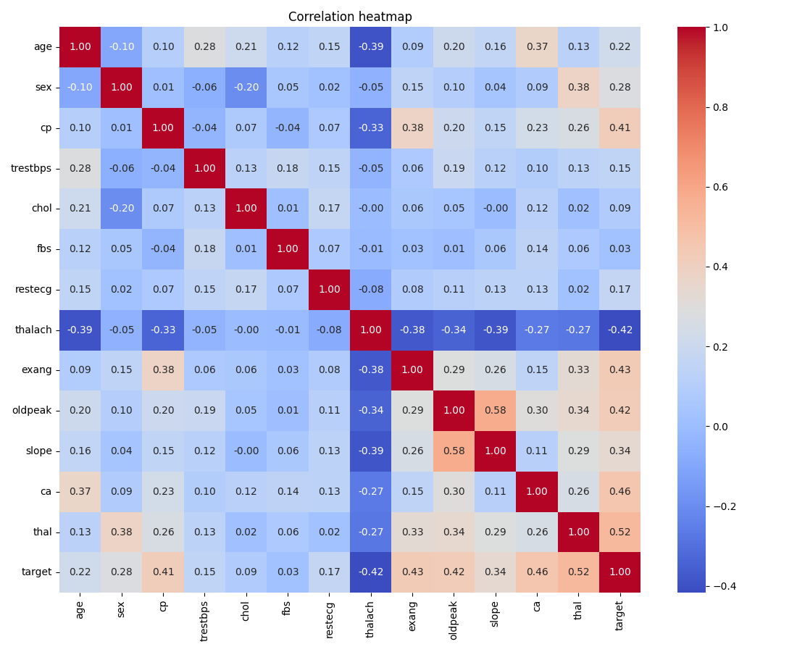
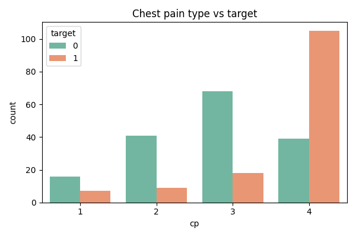
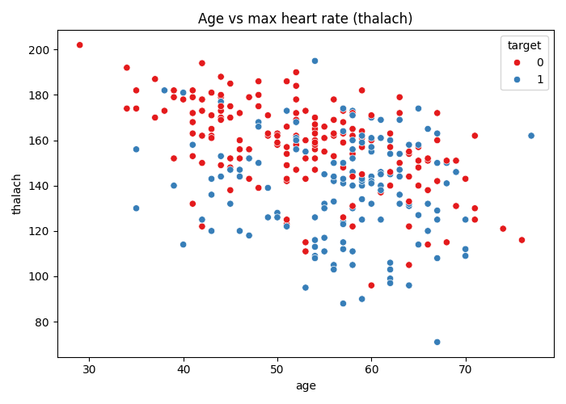
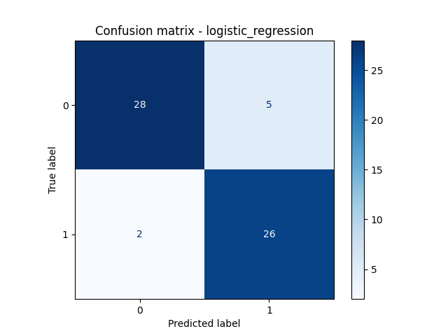
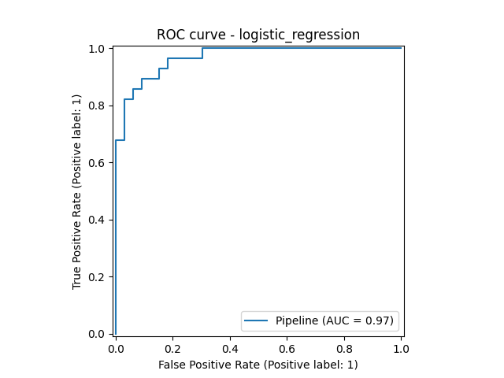
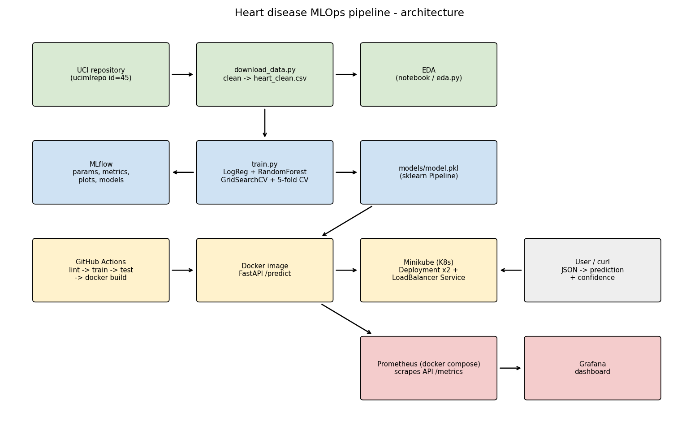

**GitHub repository:** https://github.com/2025ae05649-source/MLOps-cycle-assignment

# 1. Introduction

The goal of this assignment is to build a machine learning classifier that predicts the risk of heart disease from patient health data, and then take it through the full MLOps cycle: data download, EDA, model training, experiment tracking, testing, CI/CD, Docker, Kubernetes deployment and monitoring.

Tools used:

| Area                | Tool                  |
| ------------------- | --------------------- |
| Language            | Python 3.12           |
| Data / ML           | pandas, scikit-learn  |
| Plots               | matplotlib, seaborn   |
| Experiment tracking | MLflow                |
| API                 | FastAPI + Uvicorn     |
| Testing / lint      | pytest, flake8        |
| CI/CD               | GitHub Actions        |
| Container           | Docker                |
| Deployment          | Kubernetes (Minikube) |
| Monitoring          | Prometheus + Grafana  |

# 2. Setup / Installation

```bash
git clone https://github.com/2025ae05649-source/MLOps-cycle-assignment.git
cd heart-disease-mlops
python3 -m venv .venv
source .venv/bin/activate
pip install -r requirements.txt

python data/download_data.py   # get + clean data
python src/eda.py              # EDA plots
python src/train.py            # train + log to MLflow
pytest -v                      # tests
mlflow ui --port 5001          # view experiments
```

Docker, Minikube and docker compose commands are given in the sections below and in README.md.

# 3. Data Acquisition and Cleaning

**Dataset:** Heart Disease UCI (Cleveland), 303 patients, 13 features + target.

The data is downloaded with the official UCI python package `ucimlrepo` (`fetch_ucirepo(id=45)`) in `data/download_data.py`. On macOS the python.org Python does not have SSL certificates set up, so the script points `SSL_CERT_FILE` to the `certifi` bundle before downloading.

Features: age, sex, cp (chest pain type), trestbps (resting blood pressure), chol (cholesterol), fbs (fasting blood sugar > 120), restecg, thalach (max heart rate), exang (exercise induced angina), oldpeak (ST depression), slope, ca (number of major vessels), thal.

Cleaning steps:

1. Missing values: only `ca` (4 rows) and `thal` (2 rows) had missing values. Both are categorical, so I filled them with the mode instead of dropping rows (dataset is small).
2. Target: the original `num` column has values 0-4. I converted it to binary: `target = 1 if num > 0 else 0` (presence / absence of disease).
3. Duplicates dropped (there were none).
4. Categorical columns stored as floats were converted to int.

The cleaned data is saved as `data/heart_clean.csv` and committed to the repo.

# 4. Exploratory Data Analysis

EDA is in `notebooks/eda.ipynb` (with comments) and `src/eda.py` (saves the same plots to `reports/figures/`).

**Class balance:** 164 patients without disease and 139 with disease (54% / 46%). The classes are fairly balanced, so no resampling was needed, but I still look at precision, recall and ROC-AUC and not only accuracy.

{width=45%}

**Histograms:** age is roughly normal (mostly 40-65). `oldpeak` is right skewed (about one third are 0). `chol` has 4 values above 400 which I kept as they can be real values.

{width=85%}

**Correlation:** the features most correlated with the target are `thal` (0.52), `ca` (0.46), `exang` (0.43), `oldpeak` (0.42), `cp` (0.41) and `thalach` (-0.42, higher max heart rate = lower risk). `fbs` and `chol` have almost no correlation with the target.

{width=80%}

**Chest pain type:** type 4 (asymptomatic) has 105 disease cases vs 39 no-disease, which is a strong signal.

{width=50%}

{width=55%}

# 5. Feature Engineering and Model Development

## 5.1 Features

Based on the EDA I split the features into three groups (`src/preprocess.py`):

| Group                   | Columns                               | Transformation                          |
| ----------------------- | ------------------------------------- | --------------------------------------- |
| Numeric                 | age, trestbps, chol, thalach, oldpeak | StandardScaler                          |
| Categorical (>2 values) | cp, restecg, slope, ca, thal          | OneHotEncoder (handle_unknown="ignore") |
| Binary                  | sex, fbs, exang                       | passthrough                             |

These are combined in a scikit-learn `ColumnTransformer`, and the transformer + classifier are put into one `Pipeline`. This means the saved model file contains the preprocessing too, so the API only needs to send raw values and the same scaling/encoding is always applied (no training/serving mismatch).

## 5.2 Models and tuning

Data split: 80% train / 20% test, stratified, `random_state=42`.

Two models were trained (`src/train.py`):

1. **Logistic Regression** - simple, fast, interpretable baseline. Grid: `C` in [0.01, 0.1, 1, 10].
2. **Random Forest** - non-linear, handles interactions. Grid: `n_estimators` [100, 200], `max_depth` [4, 6, None], `min_samples_split` [2, 5].

Tuning: `GridSearchCV` with 5-fold `StratifiedKFold`, scoring = ROC-AUC. After finding the best parameters, I ran `cross_validate` again on the training data to get CV accuracy, precision, recall and ROC-AUC, and finally evaluated on the held-out test set.

## 5.3 Results

| Model               | Best params                         | CV acc | CV ROC-AUC | Test acc | Test precision | Test recall | Test F1 | Test ROC-AUC |
| ------------------- | ----------------------------------- | ------ | ---------- | -------- | -------------- | ----------- | ------- | ------------ |
| Logistic Regression | C=1                                 | 0.847  | 0.904      | 0.885    | 0.839          | 0.929       | 0.881   | **0.968**    |
| Random Forest       | 200 trees, max_depth=4, min_split=2 | 0.835  | 0.902      | 0.869    | 0.857          | 0.857       | 0.857   | 0.949        |

**Model selection:** both models are close in cross-validation. Logistic Regression has a higher test ROC-AUC and a much higher recall (0.93 vs 0.86). For a medical screening problem, missing a sick patient (false negative) is worse than a false alarm, so higher recall is preferred. It is also simpler and easier to explain. So **Logistic Regression** was selected as the final model and saved to `models/model.pkl`. Note the test set is small (61 rows) so the difference between the models is not very big.

{width=45%}
{width=45%}

# 6. Experiment Tracking (MLflow)

MLflow is used in `src/train.py`. All runs go into the experiment **heart-disease** (stored locally in `mlruns/`). For every model run the following is logged:

- **Parameters:** model type and best hyperparameters from the grid search
- **Metrics:** cv_accuracy, cv_precision, cv_recall, cv_roc_auc, test_accuracy, test_precision, test_recall, test_f1, test_roc_auc
- **Artifacts:** confusion matrix and ROC curve plots (in `plots/`)
- **Model:** the full sklearn pipeline with `mlflow.sklearn.log_model` (with an input example and signature)

To view: `mlflow ui --port 5001` and open http://localhost:5001. The runs can be compared side by side in the UI. In CI the `mlruns/` folder is also uploaded as a workflow artifact.

[INSERT SCREENSHOT: screenshots/01_mlflow_runs.png]

[INSERT SCREENSHOT: screenshots/02_mlflow_run_detail.png]

# 7. Model Packaging and Reproducibility

- The final model is saved as `models/model.pkl` with joblib. It is a full sklearn `Pipeline` (preprocessing + classifier), so loading this one file is enough to make predictions.
- The model is also saved in MLflow format inside each run.
- `models/metrics.json` stores the results and best params of both models.
- `requirements.txt` has pinned versions of all packages used for training and tests. `requirements-api.txt` is a smaller list just for the Docker image (no MLflow or plotting libraries), which keeps the image smaller.
- `random_state=42` is used for the split, CV folds and Random Forest, so training gives the same results each time.
- I checked reproducibility by creating a fresh virtual environment, installing only `requirements.txt` on a clean copy of the repo, and running lint, training and tests - same results (test ROC-AUC 0.9675, 13 tests passed).

# 8. CI/CD Pipeline and Testing

## 8.1 Unit tests

Tests are in `tests/` (13 tests, pytest):

| File          | What it tests                                                                                                                    |
| ------------- | -------------------------------------------------------------------------------------------------------------------------------- |
| test_data.py  | cleaning fills missing values, target becomes binary, cleaned file is valid, error on missing columns, preprocessor output shape |
| test_model.py | both models defined, model accuracy > 0.7, evaluate() returns all metrics in [0,1], predict() on a sample                        |
| test_api.py   | /health returns ok, /predict returns prediction + confidence, missing field returns 422, /metrics works                          |

[INSERT SCREENSHOT: screenshots/03_pytest.png]

## 8.2 GitHub Actions

Workflow file: `.github/workflows/ci.yml`. It runs on push to main, on pull requests, and manually.

**Job 1 - lint-test-train**

1. Checkout and set up Python 3.12 (with pip cache)
2. Install `requirements.txt`
3. Lint with flake8
4. Train models (`python src/train.py`)
5. Run pytest (writes `test-results.xml`)
6. Upload artifacts: `model-and-metrics` (model, metrics.json, plots, test results) and `mlruns`

**Job 2 - docker-build** (runs only if job 1 passed)

1. Download the trained model artifact
2. Build the Docker image
3. Start the container and call `/health` and `/predict` with `curl -f`

If any step fails (lint error, failing test, container not responding) the step exits with a non-zero code, the pipeline turns red and the logs show which step failed.

[INSERT SCREENSHOT: screenshots/04_github_actions.png]

[INSERT SCREENSHOT: screenshots/05_github_artifacts.png]

# 9. Model Containerization (Docker)

The API is written with FastAPI (`app/main.py`):

| Endpoint   | Method | Description                                            |
| ---------- | ------ | ------------------------------------------------------ |
| `/`        | GET    | welcome message                                        |
| `/health`  | GET    | health check, loads model (used by Kubernetes probes)  |
| `/predict` | POST   | JSON with 13 features -> prediction, label, confidence |
| `/metrics` | GET    | Prometheus metrics                                     |
| `/docs`    | GET    | Swagger UI (automatic in FastAPI)                      |

Input is validated with a Pydantic model (types and ranges, e.g. sex must be 0 or 1). Invalid input returns HTTP 422. Confidence is the predicted probability of the predicted class.

Dockerfile: based on `python:3.12-slim`, installs `requirements-api.txt`, copies `app/` and `models/model.pkl`, runs uvicorn on port 8000.

```bash
docker build -t heart-disease-api:v1 .
docker run -d --name heart-api -p 8000:8000 heart-disease-api:v1
curl -X POST http://localhost:8000/predict \
  -H "Content-Type: application/json" -d @sample_input.json
```

Sample response:

```json
{ "prediction": 0, "label": "no heart disease", "confidence": 0.8254 }
```

[INSERT SCREENSHOT: screenshots/06_docker_run.png]

[INSERT SCREENSHOT: screenshots/07_swagger_docs.png]

# 10. Production Deployment (Kubernetes - Minikube)

I deployed to a local Kubernetes cluster using Minikube (Docker driver).

- `k8s/deployment.yaml`: Deployment `heart-api` with **2 replicas**, CPU/memory requests and limits, readiness and liveness probes on `/health`. `imagePullPolicy: IfNotPresent` because the image is loaded directly into minikube (not pushed to a registry).
- `k8s/service.yaml`: Service of type **LoadBalancer**, port 80 -> container port 8000.

```bash
minikube start --driver=docker
minikube image load heart-disease-api:v1
kubectl apply -f k8s/
kubectl get pods,svc
minikube service heart-api-service --url
curl -X POST <URL>/predict -H "Content-Type: application/json" -d @sample_input.json
```

On minikube the LoadBalancer stays `<pending>` until `minikube tunnel` is running; alternatively `minikube service heart-api-service --url` gives a local URL. Both pods became Ready and `/predict` through the service returned the same prediction as the local container.

**Access instructions (local testing):** run the commands above, then open `<URL>/docs` in a browser.

[INSERT SCREENSHOT: screenshots/08_kubectl_pods.png]

[INSERT SCREENSHOT: screenshots/09_k8s_predict.png]

# 11. Monitoring and Logging

**Logging:** the API uses Python `logging`. A FastAPI middleware logs every request (method, path, status code, time taken), and `/predict` also logs the input and the prediction with confidence. Logs can be seen with `docker logs heart-api` or `kubectl logs -l app=heart-api`.

**Metrics:** using `prometheus-client` the API exposes on `/metrics`:

- `api_requests_total` (labels: method, endpoint, status)
- `api_request_latency_seconds` (histogram per endpoint)
- `predictions_total` (label: prediction class)

**Prometheus + Grafana:** `docker-compose.yml` starts the API, Prometheus (scrapes `/metrics` every 5 seconds) and Grafana (port 3300). The Prometheus datasource and a dashboard are provisioned automatically from `monitoring/grafana/`. The dashboard "Heart Disease API" shows total requests, predictions per class, error count, requests per second per endpoint and average latency. `send_requests.sh` sends test traffic (including one invalid request so the error panel shows something).

[INSERT SCREENSHOT: screenshots/10_grafana.png]

[INSERT SCREENSHOT: screenshots/11_prometheus.png]

# 12. Architecture



Flow: data is downloaded from UCI and cleaned -> EDA -> training with GridSearchCV, logged to MLflow -> best pipeline saved as model.pkl -> packaged into a Docker image with FastAPI -> deployed on Minikube with 2 replicas behind a LoadBalancer service. GitHub Actions automates lint, training, tests and the Docker build on every push. Prometheus scrapes API metrics and Grafana shows them.

# 13. Challenges and Learnings

- **SSL error when downloading data** on macOS - fixed by using the `certifi` certificate bundle.
- **Port conflicts on Mac** - port 5000 is used by AirPlay so MLflow UI runs on 5001; Grafana is mapped to 3300.
- **Image not found in minikube** - minikube has its own Docker, so the image has to be loaded with `minikube image load` and `imagePullPolicy` set to `IfNotPresent`.
- **LoadBalancer pending on minikube** - needs `minikube tunnel` or `minikube service --url`.
- Putting preprocessing inside the sklearn Pipeline made the API much simpler and avoided mistakes between training and serving.

**Possible improvements:** push the image to a registry (Docker Hub / GHCR) from CI, deploy Prometheus/Grafana inside the cluster too, use the MLflow model registry, add data drift monitoring.

# 14. Links

- Code repository: https://github.com/2025ae05649-source/MLOps-cycle-assignment
- Demo video: [PASTE VIDEO LINK HERE]
- Dataset: https://archive.ics.uci.edu/dataset/45/heart+disease
